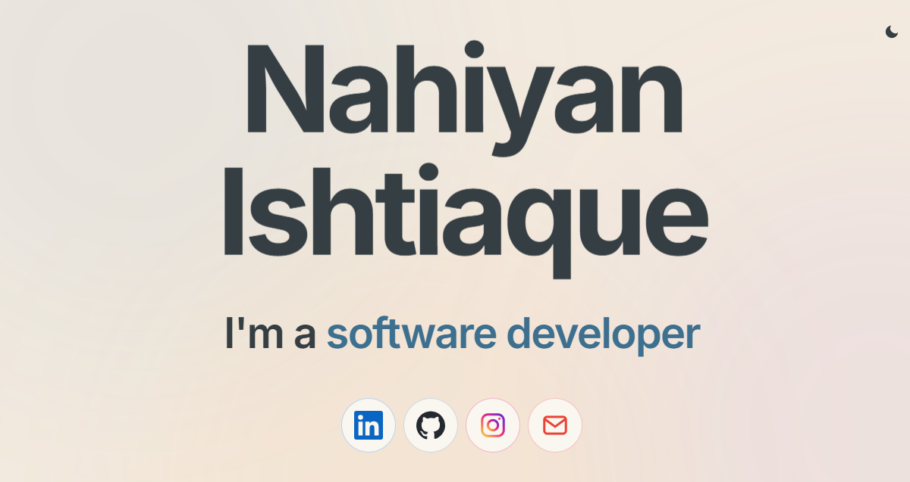
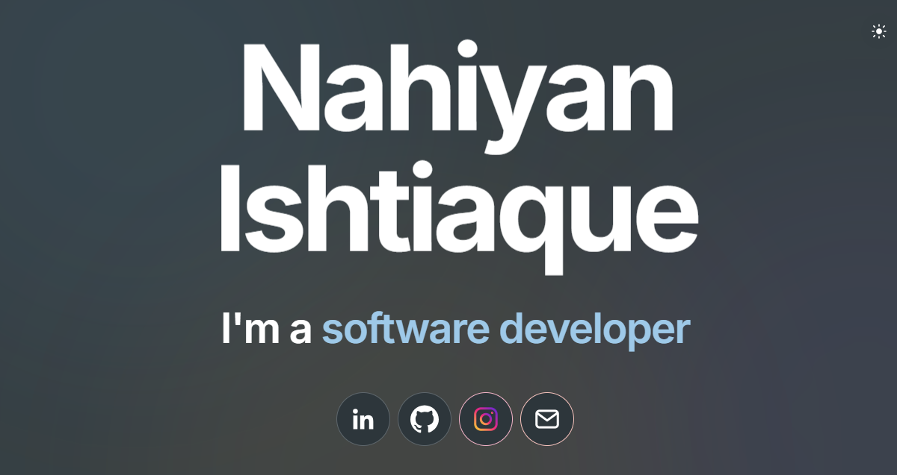
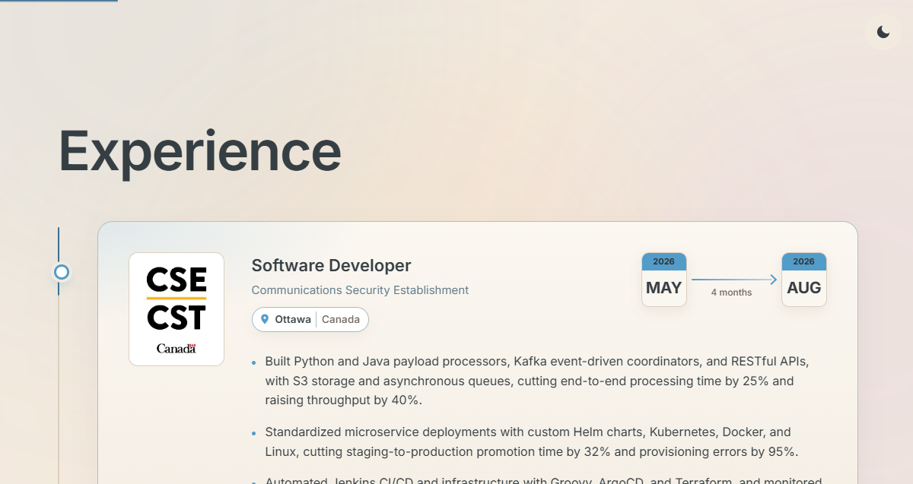
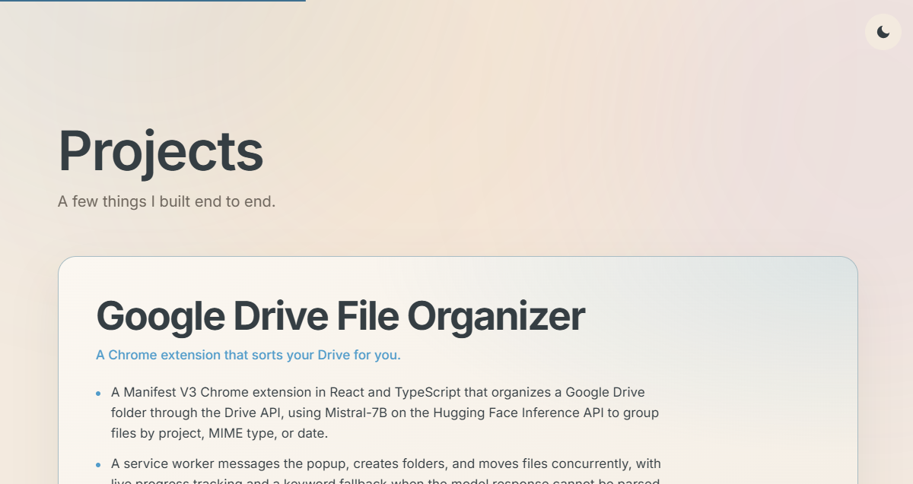
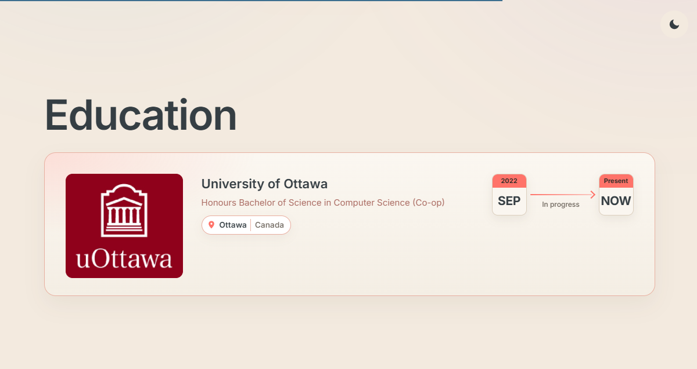

# Nahiyan Ishtiaque

Hi, I'm Nahiyan, a Computer Science co-op student at the University of Ottawa and a software developer focused on backend, DevOps, and full-stack work. Here's my personal website to show the world who I am: [nahiyanishtiaque.com](https://nahiyanishtiaque.com). Hope you enjoy!

## Contact

- Email: [nahiyan.ishtiaque@gmail.com](mailto:nahiyan.ishtiaque@gmail.com)
- LinkedIn: [linkedin.com/in/nahiyan-ishtiaque](https://linkedin.com/in/nahiyan-ishtiaque)
- GitHub: [github.com/nahiyani](https://github.com/nahiyani)
- Instagram: [instagram.com/nahiyan_.i](https://instagram.com/nahiyan_.i)
- Website: [nahiyanishtiaque.com](https://nahiyanishtiaque.com)

## Website

